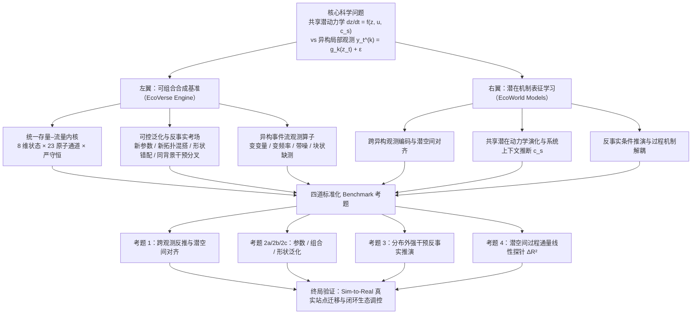

# EcoVerse 研究主线与工作区指南针（Research Compass）

> **文档定位**：本文档是 `EcoVerse` 整个工作区的顶层研究主线与方向锚点（North Star）。所有数据基准扩展、模型架构设计、训练目标构造、评测分析与论文叙事，均应以本文档作为首要校准依据。

---

## 一、北极星声明

> **课题名称**：*EcoVerse —— 跨生态系统共享动力学规律的可组合合成基准与潜在机制表征学习*
>
> **核心科学问题**：真实生态系统在潜空间里存在共享的宏观运行规律，但人类在每个站点只能以不同变量、不同频率观测到局部表象（$\dot{z} = f_\theta(z, u, c_s),\ y_t^{(k)} = g_k(z_t) + \varepsilon$）。一个基于跨系统、异构观测训练的深度学习模型，能否不仅把曲线预测准，而是真正“读懂”底层可复用的生态机制，并推演未见过的新系统在新驱动或人为干预下的变化？

### 核心数学抽象与语义映射

| 符号 | 生态学与系统含义 | 机器学习 / 表征学习视角 | 在 `EcoVerse` 中的工程锚定 |
|---|---|---|---|
| $z(t)$ | 跨生态系统共享的底层潜状态（物质/能量存量与隐含动力学状态） | 跨站点、跨传感器共享的统一潜空间表征 | 由 8 维物理存量 $(N, P_1, P_2, Z_1, Z_2, D, O, C)$ 及 23 条原子过程通量 $\mathbf{r}(t)$ 显式锚定 |
| $u(t)$ | 外部环境强迫与边界驱动 | 条件动力学系统的外生控制输入 | 4 维连续光滑解析驱动：光照 $I(t)$、温度 $T(t)$、水文冲刷 $q(t)$、外源营养 $N_{\text{in}}(t)$ |
| $c_s$ | 特定站点的系统基因（生态类型、结构拓扑、过程参数、功能响应形态） | 系统级上下文 / 领域不变动力学上的特异条件 | `SystemSpec`（5 大预设 + 4 类未见混搭、状态/通道开关、参数与形状族配置） |
| $\dot{z} = f_\theta(z, u, c_s)$ | 跨生态系统**共享、可组合、可复用**的宏观动力学规律 | 统一学习的潜在演化算子（生态世界模型内核） | 统一存量–流量动力学内核 $\frac{d\mathbf{x}}{dt} = \mathbf{S}^\top \mathbf{r}(\mathbf{x},\mathbf{u},\boldsymbol{\theta}) + \text{边界吞吐}$ |
| $y_t^{(k)} = g_k(z_t) + \varepsilon$ | 第 $k$ 类站点/传感器的局部、异构、带噪、非均匀观测表象 | 变变量子集、变采样频率、含块状缺测的观测算子 | 变长事件流观测管线（`obs/`）与 A（高频水质）/ B（低频生态）/ C（单变量遥感）三套监测套餐 |

---

## 二、研究主线的双翼结构与核心逻辑

整个课题围绕**“基准筑基”**与**“机制表征”**两个紧密咬合的支柱展开：

1. **左翼：可组合合成基准（Composable Synthetic Benchmark）**
   - **为什么必须建合成基准**：真实野外观测站天然缺失全状态真值、缺失不可直接测量的过程通量（如 23 条原子通量与准确分解的 GPP/ER/NEP），更无法在严格相同的天气与暴雨序列下获取“平行宇宙反事实对照”。
   - **基准的核心设计原则**：不是堆砌互不相关的仿真器，而是用**一套统一、守恒、可组合的存量–流量数学内核**衍生河流、浅水湖泊、陆地、经典食物网、恒化器及跨预设未见混搭，把“共享底层规律 + 异构局部观测 + 精确反事实分叉”一次性变成可量化、可归因的科学考场。
2. **右翼：潜在机制表征学习（Latent Mechanism Representation Learning）**
   - **核心判别标准**：区分**“拟合曲线的表象模型”**与**“读懂机制的生态世界模型”**。如果一个模型只记住了训练分布内特定传感器的波形相关性，它会在更换观测变量、改变系统结构组合或施加分布外强干预时迅速崩塌。
   - **三大核心科学假设**：
     1. **跨观测不变性（Cross-Observation Invariance）**：同一生态系统在不同观测算子 $g_k$ 下产生的异构事件流，应能被映射到一致的潜状态 $z_t$，并由此反推出未被直接观测的状态与过程通量。
     2. **机制可复用与可组合性（Reusable & Composable Mechanisms）**：模型在潜空间中学到的不是孤立的“站点模板”，而是可迁移到新参数、新通道混搭结构，乃至在功能反应形状错配（单调 $\to$ 单峰抑制）下依然稳健的底层生态机制。
     3. **因果与反事实外推性（Counterfactual Extrapolation）**：真正理解 $\dot{z} = f_\theta(z, u, c_s)$ 的模型，能够在未见过的强外部驱动变化或人为干预下，正确推演新系统的演化轨迹与稳态转移方向。

---

## 三、科学问题 $\leftrightarrow$ Benchmark 四道考题与现状诊断

为了避免研究沦为空泛口号，`EcoVerse v0` 将核心科学问题精确拆解为四道不可绕过的标准化考题，并以两层事件流 Transformer 验收基线（详见 [acceptance_v0.md](acceptance_v0.md)）标定当前起点：

| 科学子追问 | 对应数学机制 | Benchmark 考题与划分 | 核心评判指标 | `v0` 弱基线现状（研究起点） |
|---|---|---|---|---|
| **不同传感器只看到局部表象，能否还原同一底层状态？** | $y_t^{(k)} = g_k(z_t) + \varepsilon$ 的跨视角反演与对齐 | **考题 1**（`test_1_obs`，300 系统 × A/B/C 套餐） | 未观测有效状态 NRMSE ↓、通量 $R^2$ ↑、跨观测潜空间余弦相似度 ↑ | 套餐 A/B/C 未观测 NRMSE `0.974 / 0.962 / 0.978`；跨观测余弦相似度 `0.380`；通量 $R^2 \le 0.001$ |
| **学到的是死记波形，还是可复用、可组合的生态机制？** | $f_\theta(z, u, c_s)$ 跨参数、跨结构、跨形状族的泛化 | **考题 2a / 2b / 2c**（新参数 300 / 新拓扑混搭 400 / 单峰形状错配 300） | 零样本状态 NRMSE ↓、原子通量与 GPP/ER $R^2$ ↑、形状错配衰减幅度 | 状态 NRMSE `0.673 / 0.749 / 0.569`，但通量平均 $R^2$ 仅 `0.075 / -0.009 / -0.336`（未真正理解过程通量） |
| **面对未见强驱动或人为干预，能否做出因果一致的推演？** | 干预注入后 $f_\theta$ 的分布外动力学外推 | **考题 3**（`test_3_interv`，300 系统，4 类分布外强干预） | 反事实轨迹 NRMSE ↓、稳态变化方向准确率 ↑ | 反事实 NRMSE `0.834`；稳态变化方向准确率 `55.83%`（仅略高于随机猜测） |
| **模型是否真的在潜空间里“读懂”了底层生态机制？** | 潜表征 $z_t$ 是否线性可解地编码了过程速率 $\mathbf{r}(t)$ | **考题 4**（全测试集 1,600 系统 GPU 岭回归线性探针） | $R^2_{\text{pretrain}}$ 及相对同架构随机编码器的净增益 $\Delta R^2$ ↑ | 原子通量平均 $\Delta R^2 = +0.0373$（`0.0461` vs `0.0088`）；GPP/ER/NEP 净增益均 $< 0.02$ |

> **关键诊断**：当前基线结果清晰证明了课题的真实难度——**普通事件流监督训练只能勉强拉低部分同分布状态误差，远远谈不上“读懂机制”**。如何显著撬动上述四类机制指标（尤其是跨观测对齐、未观测状态/过程通量还原、未见组合/形状泛化、强干预方向准确率与潜空间 $\Delta R^2$），正是下一阶段模型与表征学习研究的主战场。

---

## 四、总体研究路线图与当前坐标

| 阶段 | 研究主题 | 核心目标与交付物 | 当前状态 |
|---|---|---|---|
| **Phase 0 · 基准筑基（`v0`）** | 可组合合成引擎与四道考题闭环 | 8 维状态 × 23 条通道严格守恒核、6,000 系统 Zarr 真值库、异构事件流 PyTorch 管线、四道考题与 GPU 线性探针 | **已完成并验收**（见 [acceptance_v0.md](acceptance_v0.md)） |
| **Phase 1 · 核心攻关（模型与表征）** | **跨系统潜在机制表征学习** | 围绕 $\dot{z}=f_\theta(z,u,c_s)$ 与 $y_t^{(k)}=g_k(z_t)+\varepsilon$，探索事件流编码器、跨观测多视角对齐、隐式系统上下文 $c_s$ 推断、潜在神经动力学/世界模型、反事实干预建模与可解释机制探针，在四道考题上形成系统对比与方法突破 | **当前主攻阶段** |
| **Phase 2 · 基准升维（`v1` / `v2`）** | 复杂生态网、随机性与空间耦合 | `v1`：Niche Model 任意维稀疏食物网拓扑泛化；`v2`：升级为 SDE（过程噪声、慢漂移与临界转变）及 1D 河网/斑块空间耦合 | 规划预留（接口约定见 [ecoverse_dev_plan.md](ecoverse_dev_plan.md#9-给-v1-预留的三条小约定写-v0-时顺手守住)） |
| **Phase 3 · 虚实迁移（`v3`）** | Sim-to-Real 迁移与闭环生态调控 | 接入真实观测网（USGS/StreamPULSE 河流、LTER 湖泊、FLUXNET 通量塔等），验证合成预训练机制表征向真实站点的零样本/少样本迁移，并贯通 `obs/env.py` 调控闭环 | 远期终局目标 |

---

## 五、工作区决策准绳与防跑偏红线

在推进任何新模型、新损失函数、新实验或工程改动前，请用以下五条准则做“指南针自检”：

1. **机制优先，拒绝纯刷曲线**：如果一项设计只能提升同分布观测变量的短期拟合分数，却无法改善跨观测重构（考题 1）、组合/形状泛化（考题 2b/2c）、强干预推演（考题 3）或潜空间探针 $\Delta R^2$（考题 4），则偏离了研究主线。
2. **原生面向异构观测**：模型与接口必须把“变量子集不固定、采样频率不规则、时间戳异步、块状缺测”视为第一性设定，禁止退化为固定通道数、固定等距网格的常规多变量时间序列模型假设。
3. **显式服务于“共享动力学 + 系统上下文”拆解**：架构与训练范式设计应持续追问——模型如何从有限的局部观测历史中识别系统上下文 $c_s$？如何保证共享演化算子 $f_\theta$ 在新系统与新干预下仍具物理与生态一致性？
4. **守住评测与可复现红线**：
   - 严禁使用测试集统计量做归一化（严格使用训练集 `norm_stats.json`）；
   - 严禁破坏 `splits.json` 划分隔离与留出设定（2b 混搭、2c 单峰形状、考题 3 强干预分布外区间）；
   - 潜空间探针必须保留同架构随机初始化对照并报告净增益 $\Delta R^2$，防止把架构归纳偏置误判为“学到了机制”；
   - 状态与通量评分严格遵守 `effective_state_mask` 与 `channel_mask` 掩码约定。
5. **保持向 `v1`–`v3` 的演进兼容**：新模块尽量保持变量维度与通道数由元数据驱动，不把 `8` 维状态或 `23` 条通道写死在通用表征与数据接口中，确保方法能平滑扩展到任意维生态网络与真实站点数据。

---

## 六、工作区核心文档导航

| 文档 | 职责边界 | 何时查阅 |
|---|---|---|
| **[RESEARCH_COMPASS.md](RESEARCH_COMPASS.md)**（本文档） | **研究指南针**：定义顶层科学问题、理论框架、四道考题映射、研究路线与防跑偏准绳 | 构思新方法、定实验主线、写论文故事、校偏方向时 |
| **[README_zh.md](README_zh.md)** / **[README.md](README.md)** | **仓库门户与快速上手**：环境安装、目录总览、数据生成与端到端评测命令 | 首次接触仓库或复跑标准流程时 |
| **[ecoverse_dev_plan.md](ecoverse_dev_plan.md)** | **`v0` 工程与数学规格书（rev3）**：完整公式、23 条通道定义、参数先验、质检与存储 Schema | 核对底层物理方程、参数范围或扩展仿真引擎时 |
| **[acceptance_v0.md](acceptance_v0.md)** | **`v0` 全量验收与基线档案**：6,000 系统质检核验、守恒测试与首个基线四道考题实测记录 | 查验数据资产完整性或对照基线分数时 |
